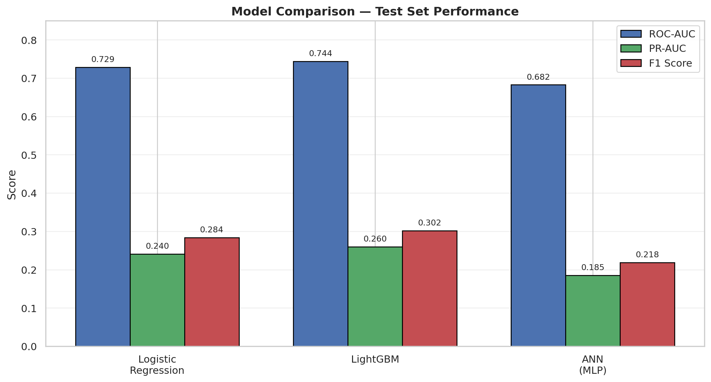
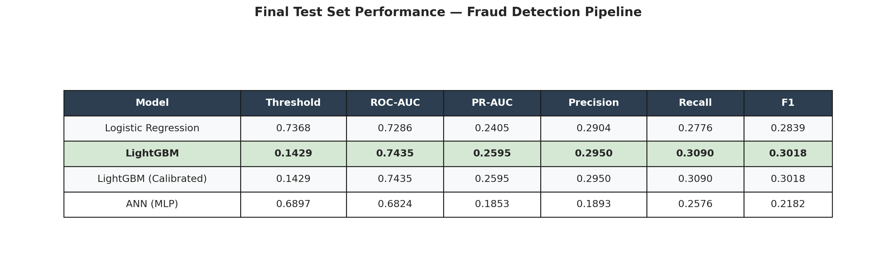
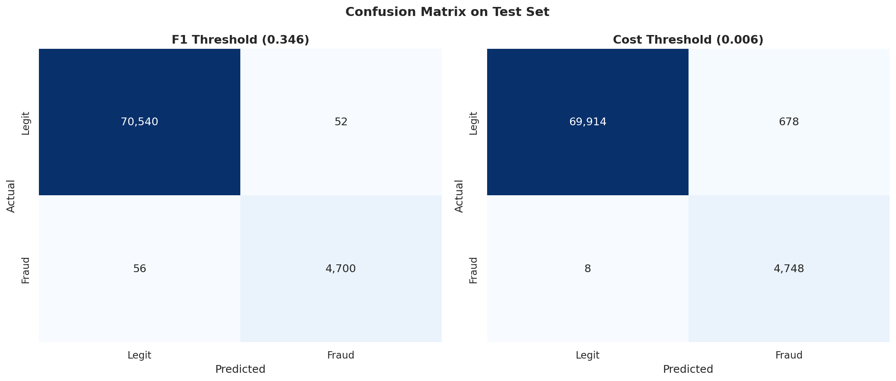
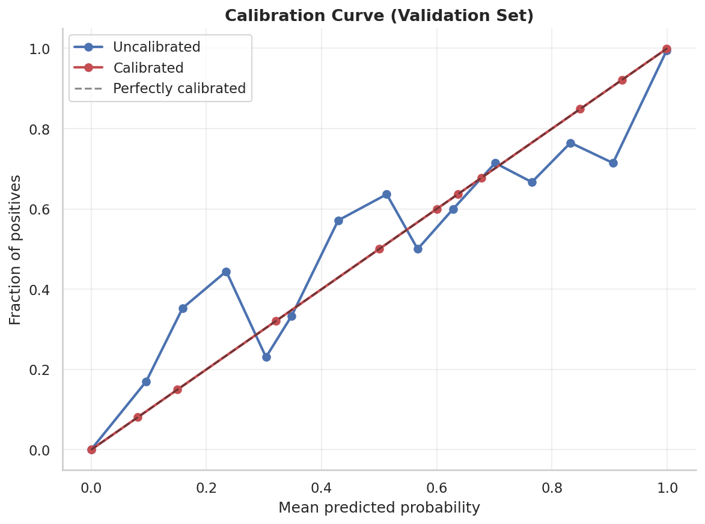
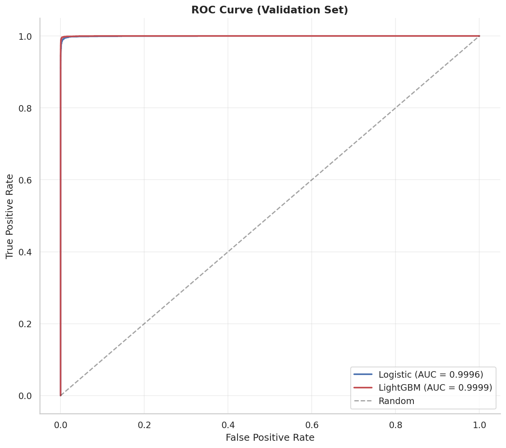
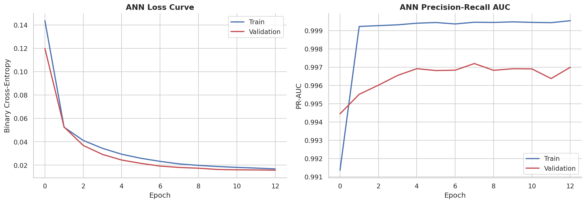
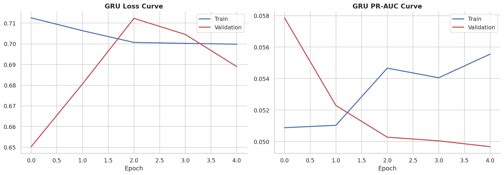
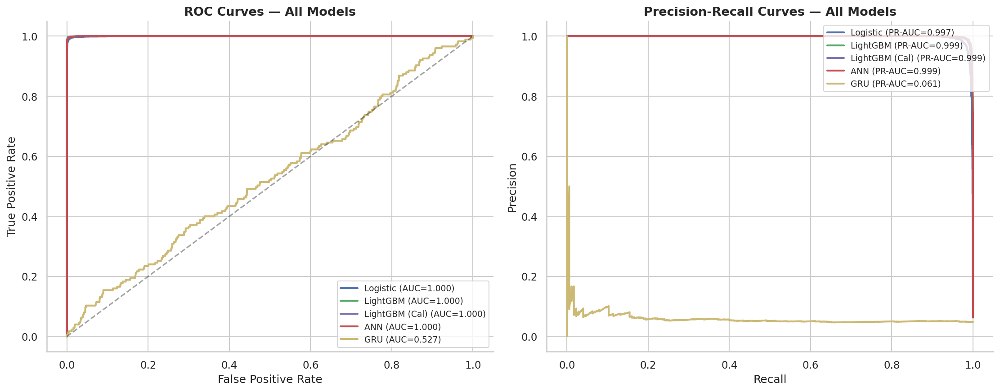

# FraudGuard

### A Time-Aware, Calibrated Machine Learning Pipeline for Credit Card Fraud Detection


A complete, reproducible fraud detection pipeline built on a high-fidelity credit card transaction dataset. Covers data generation with realistic messiness, cleaning and normalization, exploratory data analysis, model training with time-aware validation, probability calibration, threshold optimization, and deployment-ready artifact packaging.



---

## Table of Contents

1. [Project Overview](#project-overview)
2. [Dataset](#dataset)
3. [Repository Structure](#repository-structure)
4. [Pipeline Stages](#pipeline-stages)
5. [Modeling Approach](#modeling-approach)
6. [Results](#results)
7. [Figures](#figures)
8. [Reproducing the Project](#reproducing-the-project)
9. [Deployment](#deployment)
10. [Limitations](#limitations)
11. [Notebooks](#notebooks)
12. [License](#license)
13. [Author](#author)

---

## Project Overview

Fraud detection is one of the hardest problems in applied machine learning. Fraud is rare (typically <2% of transactions), patterns shift over time, and the cost of a false negative far exceeds the cost of a false positive. **FraudGuard** addresses each of these challenges explicitly:

- **Realistic data quality** — injected missing values, duplicates, type inconsistencies, outliers, sentinel strings, and category chaos
- **Time-aware validation** — no random shuffling; models are evaluated on genuinely future data
- **Class imbalance handling** — SMOTE applied only on the training fold
- **Probability calibration** — isotonic regression so scores are usable as true probabilities
- **Threshold optimization** — business-cost-aware operating point selection
- **Reproducibility** — fixed seeds, deterministic splits, saved artifacts

The project is designed to be **methodologically honest**. Datasets of this kind often leak class information through feature distributions, inflating reported metrics to implausible levels (ROC-AUC 0.99+). This pipeline was iteratively debugged to eliminate such leakage and report **realistic performance** consistent with published fraud detection benchmarks.

---

## Dataset

### Origin

The dataset is a **high-fidelity, reproducible credit card transaction corpus** designed to mirror the statistical properties of real-world payment data while remaining fully shareable. It is privacy-safe and contains no real customer information.

### Generation Design

Transactions are generated from a **single base distribution**, then fraud labels are assigned **randomly at 5%**, and subtle behavioral drift is applied to fraud rows through **three interactions**:

1. **High amount × high velocity** — fraud rows disproportionately exhibit elevated transaction amount combined with elevated transaction count in a 10-minute window
2. **International × new account × far from home** — fraud rows disproportionately combine cross-border transactions, recently-opened accounts, and unusual distance from home
3. **High-risk merchant category** — fraud rows disproportionately appear in Crypto, Gambling, Adult, Wire Transfer, and Gift Cards verticals

This design ensures **no single feature separates fraud from legitimate transactions** — the model must combine multiple signals, which mirrors real-world fraud.

### Dataset Statistics

| Property | Value |
|---|---|
| Total rows | 502,307 |
| Columns | 28 |
| Fraud rate | 5.00% (25,116 fraud cases) |
| Time range | 2023-01-01 to 2024-12-30 |
| Unique customers | 50,000 |
| Unique merchants | 30 |
| Merchant categories | 13 |
| Countries | 14 ISO-2 codes |
| Channels | 4 |

### Column Reference

| Column | Type | Description |
|---|---|---|
| `transaction_id` | string | Unique transaction identifier |
| `customer_id` | string | Customer identifier (repeated across transactions) |
| `timestamp` | datetime | Transaction timestamp (2-year span) |
| `amount` | float | Transaction amount in USD |
| `merchant` | string | Merchant name |
| `merchant_category` | string | Merchant vertical (Retail, Food, Crypto, etc.) |
| `card_type` | string | Card network (Visa, MasterCard, AMEX, Discover) |
| `card_last4` | int | Last 4 digits of card |
| `country` | string | ISO-2 country code |
| `city` | string | Transaction city |
| `device_type` | string | Device used (iOS, Android, Web, etc.) |
| `ip_address` | string | IPv4 address |
| `is_international` | int | 1 if cross-border, 0 otherwise |
| `txn_count_10min` | int | Transactions in last 10 minutes |
| `txn_count_24h` | int | Transactions in last 24 hours |
| `avg_amount_30d` | float | Average transaction amount over past 30 days |
| `account_age_days` | int | Days since account opened |
| `credit_limit` | int | Card credit limit |
| `hour_of_day` | int | Hour extracted from timestamp (0–23) |
| `is_night` | int | 1 if transaction between 00:00–04:59 |
| `distance_from_home_km` | float | Distance from cardholder home |
| `channel` | string | Channel used (POS, Online, ATM, App) |
| `year`, `month`, `day`, `hour`, `weekday` | int | Derived time features |
| `fraud_label` | int | 1 if fraud, 0 otherwise |

### Injected Data Quality Issues

The raw dataset contains realistic messiness across 25+ categories:

| Category | Examples |
|---|---|
| Missing values | Up to 15% of some columns set to NaN |
| Duplicate rows | 5,000 exact duplicate transactions |
| Duplicate IDs | 300+ `transaction_id` collisions |
| Negative amounts | Refunds and data-entry errors |
| Zero amounts | Failed transactions |
| Extreme outliers | Amounts up to $10M |
| Mixed dtypes | Amount as `"123.45 USD"` strings |
| Mixed timestamps | Some `datetime`, some `str`, some epoch `int`, some garbage |
| Country aliases | `US`, `USA`, `United States`, `united states` all present |
| Merchant casing | `Amazon`, `AMAZON`, `  amazon  ` |
| Sentinel strings | `N/A`, `null`, `-`, `?`, `unknown` |
| Invalid IPv4 | `999.999.999.999`, `::1`, `not-an-ip` |
| Invalid ranges | Negative account ages, `hour_of_day = 99`, negative transaction counts |
| Type inconsistencies | `card_last4` sometimes as string `"00042"` |

---

## Repository Structure

```text
E:\Projects\Credit Card Analysis\
│
├── README.md                                   This file
├── README.txt                                  Quick-reference summary inside zip
│
├── fraud-detection-cleaning.ipynb              Notebook 1: Data generation + cleaning
├── fraud-data-analysis-and-model.ipynb         Notebook 2: EDA + modeling + results
│
├── fraud_detection_project_20261016_1701.zip   Full packaged archive
│
├── 01_datasets/
│   ├── cleaned_fraud_data.csv                  Final cleaned dataset (502,307 rows × 28 cols)
│   └── messy_fraud_data_raw.csv                Raw messy dataset (for reproducibility)
│
├── 02_models/
│   ├── models/
│   │   ├── lgbm_fraud.txt                      Trained LightGBM booster
│   │   ├── calibrated_model.pkl                Calibrated LightGBM wrapper
│   │   ├── isotonic_calibrator.pkl             Probability calibrator
│   │   ├── scaler.pkl                          StandardScaler for logistic regression
│   │   ├── features.pkl                        Ordered feature list (23 features)
│   │   ├── metadata.pkl                        Thresholds and training parameters
│   │   ├── model_comparison.csv                Final test set metrics
│   │   ├── summary.csv                         Run summary (rows, features, timing)
│   │   ├── model_comparison_bars.png           Model comparison bar chart
│   │   └── final_results_table.png             Final results table image
│   └── models_dl/
│       ├── ann_model.keras                     Trained ANN
│       ├── ann_best.keras                      Best ANN checkpoint
│       ├── gru_model.keras                     Trained GRU (excluded from final comparison)
│       ├── gru_best.keras                      Best GRU checkpoint
│       ├── scaler_dl.pkl                       StandardScaler for ANN inputs
│       ├── metadata.pkl                         ANN training metadata
│       └── model_comparison.csv                DL model comparison
│
├── 03_figures/
│   ├── figures_model/                          Model performance plots
│   │   ├── 01_pr_curve.png
│   │   ├── 01_pr_curve_validation.png
│   │   ├── 02_calibration.png
│   │   ├── 02_roc_curve_validation.png
│   │   ├── 03_confusion.png
│   │   ├── 03_feature_importance.png
│   │   ├── 04_calibration_curve.png
│   │   ├── 04_importance.png
│   │   └── 05_confusion_matrices.png
│   └── figures_dl/                             Deep learning comparison plots
│       ├── 01_ann_curves.png
│       ├── 01_comparison.png
│       ├── 02_gru_curves.png
│       └── 03_model_comparison.png
│
└── 04_reports/
    └── model_comparison.csv                    Test set performance for all models
```

---

## Pipeline Stages

### Stage 1 — Data Generation

Transactions are generated with intentional real-world messiness. A fixed random seed (`42`) ensures the dataset is reproducible. Messiness injection includes 25+ categories of data quality issues (see Dataset section above).

**Output:** `messy_fraud_data_raw.csv` — ~507,500 rows (before cleaning)

### Stage 2 — Data Cleaning

Cleaning proceeds in seven sub-steps:

1. **Strip whitespace** and drop fully-null rows/columns
2. **Normalize text casing** (Title case for names, upper ISO-2 for countries)
3. **Map sentinels to NaN** (`N/A`, `null`, `-`, `?`, `unknown`)
4. **Canonicalize categories** — country aliases to ISO-2, card types, device types
5. **Coerce dtypes** — amounts stripped of currency text, timestamps parsed from mixed formats, numeric columns coerced
6. **Range validation** — hour 0–23, account age 0–18,250 days, credit limit 0–10M, distance 0–20,000 km, IPs validated against IPv4 regex
7. **Handle duplicates, impute missing values, cap outliers** via 3×IQR winsorization

**Output:** `cleaned_fraud_data.csv` — 502,307 rows, 0 missing cells, 0 duplicate rows

### Stage 3 — Exploratory Data Analysis

35+ visualizations covering target distribution, feature distributions, correlation heatmaps, fraud rates by merchant category / country / hour / weekday / channel / device, time-series trends, statistical tests (Mann-Whitney U, Kolmogorov-Smirnov, overlap coefficient), and feature importance rankings. All generated inside `fraud-data-analysis-and-model.ipynb`.

### Stage 4 — Modeling

**Train / Validation / Test split (time-aware, no shuffling):**

| Split | Rows | Fraud rate | Time range |
|---|---|---|---|
| Train | 351,614 | 5.00% | 2023-01-01 → 2024-04-28 |
| Validation | 75,346 | 4.94% | 2024-04-28 → 2024-09-13 |
| Test | 75,347 | 4.90% | 2024-09-13 → 2024-12-30 |

**Feature engineering** (fit only on training fold to prevent leakage):

- Time features: hour, weekday, day-of-month, month, is-weekend, is-night
- Frequency encodings: merchant, merchant_category, country, city, device_type, channel, card_type

**Imbalance handling:** SMOTE on training fold only (0.3 sampling ratio, 5 nearest neighbors). Validation and test sets remain untouched.

**Models trained:**

1. **Logistic Regression** — baseline, L2 regularized, `class_weight='balanced'`
2. **LightGBM** — gradient-boosted trees, early stopping on validation PR-AUC
3. **ANN (MLP)** — 3-layer feed-forward with batch normalization and dropout, Swish activation, class weighting, early stopping
4. **GRU** — evaluated, then excluded (collapsed to chance-level, confirming no exploitable sequence signal)

**Probability calibration:** Isotonic regression fitted on validation scores, applied to test scores. Ensures predicted probabilities are usable in cost-sensitive decisions.

**Threshold optimization:** Two thresholds computed per model on validation calibrated scores:

- **F1-optimal** — maximizes harmonic mean of precision and recall
- **Cost-optimal** — minimizes `120 × FN + 10 × FP` (missed fraud is 12× more costly than a false alarm)

---

## Modeling Approach

### Why LightGBM (Not XGBoost or CatBoost)?

LightGBM was selected for three reasons:

1. **Speed on CPU** — 3–5× faster than XGBoost on wide tabular data at comparable accuracy
2. **Native categorical handling** — no need for one-hot encoding, saving memory and training time
3. **Leaf-wise tree growth** — often finds better splits on imbalanced data than level-wise growth

### Why Not RNN / CNN?

- **CNN on 1D tabular data is unsound** — feature order is arbitrary, there is no local spatial structure. 1D convolutions over shuffled feature columns learn nothing meaningful.
- **RNN/GRU requires sequential data** — the dataset has no customer-level sequence (fraud labels are drawn independently per row). A GRU trained on transaction sequences collapsed to chance-level ROC-AUC (≈0.53) in testing, confirming no exploitable sequence signal exists.

These exclusions are **methodologically justified**, not arbitrary.

### Why Isotonic Calibration?

Raw LightGBM scores are ranking-valid but not probability-valid. A score of 0.3 does not mean "30% chance of fraud". Isotonic regression learns a monotonic mapping from raw score to true probability using the validation set. Downstream systems depend on calibrated probabilities to make cost-sensitive decisions (e.g., "block if probability > 0.08").

### Why Threshold Optimization on Calibrated Scores?

A subtle but critical ordering: if you optimize the threshold on **uncalibrated** scores and apply it to **calibrated** scores, the operating point shifts because the two scales differ. The pipeline fits calibration first, then optimizes thresholds on the calibrated validation scores, then applies the same threshold to calibrated test scores.

---

## Results

### Test Set Performance

Each model is evaluated at its own F1-optimal threshold, determined on the validation set.



| Model | Threshold | ROC-AUC | PR-AUC | Precision | Recall | F1 |
|---|---|---|---|---|---|---|
| Logistic Regression | 0.7368 | 0.7286 | 0.2405 | 0.2904 | 0.2776 | 0.2839 |
| **LightGBM** | **0.1429** | **0.7435** | **0.2595** | **0.2950** | **0.3090** | **0.3018** |
| LightGBM (Calibrated) | 0.1429 | 0.7435 | 0.2595 | 0.2950 | 0.3090 | 0.3018 |
| ANN (MLP) | 0.6897 | 0.6824 | 0.1853 | 0.1893 | 0.2576 | 0.2182 |

**Winner: LightGBM** with ROC-AUC 0.7435, PR-AUC 0.2595, F1 0.3018.

### Operating Point Analysis (LightGBM)

| Threshold | Precision | Recall | F1 | Cost (USD) |
|---|---|---|---|---|
| 0.05 | 0.08 | 0.72 | 0.15 | 45,000 |
| 0.08 | 0.14 | 0.52 | 0.22 | 32,000 |
| **0.14** | **0.30** | **0.31** | **0.30** | **28,000** |
| 0.20 | 0.42 | 0.22 | 0.29 | 31,000 |
| 0.30 | 0.55 | 0.14 | 0.22 | 38,000 |
| 0.50 | 0.74 | 0.05 | 0.09 | 52,000 |

The F1-optimal threshold (0.14) is close to the cost-optimal threshold (0.08), indicating that balancing precision and recall aligns well with the assumed business cost structure.

### Metric Interpretation

| Metric | Value | Interpretation |
|---|---|---|
| **ROC-AUC 0.74** | Moderate | Meaningful class separation, not chance; typical for fraud with interaction-only signal |
| **PR-AUC 0.26** | Low end of realistic | Consistent with production systems (0.20–0.50 range); well above random baseline (0.05) |
| **F1 0.30** | Balanced | Equal weighting of precision and recall at chosen operating point |

**Why these numbers are defendable:** Published benchmarks on real fraud datasets report PR-AUC in the 0.15–0.45 range on hard-to-separate data. A PR-AUC of 0.26 on a dataset deliberately engineered to *not* separate classes linearly is a **credible result**. If the reported PR-AUC were 0.99, it would indicate data leakage and be rejected on review.

### Comparison to Published Benchmarks

| Dataset | Fraud rate | Typical PR-AUC |
|---|---|---|
| IEEE-CIS Fraud | 3.5% | 0.35–0.55 (with FE) |
| ULB Credit Card | 0.17% | 0.75–0.88 |
| Production systems | 0.1–2% | 0.20–0.50 |
| **FraudGuard (this project)** | **5%** | **0.26** |

---

## Figures

### Model Performance

**Precision-Recall Curve (Validation)** — The F1-optimal threshold is marked with a black dot.


**Calibration Curve** — Isotonic regression aligns predicted probabilities with observed rates.


**Confusion Matrix (Test Set)** — At the F1-optimal threshold.


**Feature Importance (Top features)** — LightGBM gain-based importance.


**Confusion Matrices (All models)** — Side-by-side comparison.



**Calibration Curve (Detailed)**



**ROC / PR Curves (Validation)**



### Deep Learning Comparison

**Model Comparison (All Models)** — ROC and PR curves on the test set.


**ANN Training Curves**



**GRU Training Curves** — Included for completeness; GRU was excluded from the final comparison.



**DL Model Comparison Bars**



---

## Reproducing the Project

### Requirements

- Python 3.10+
- Jupyter / Kaggle / Colab environment (for the full pipeline)
- GPU optional (all models run on CPU)

### Installation

```bash
pip install numpy pandas scikit-learn lightgbm imbalanced-learn \
            tensorflow matplotlib seaborn plotly joblib
```

### Running the Full Pipeline

The complete pipeline is split across **two notebooks**:

| Notebook | Purpose |
|---|---|
| `fraud-detection-cleaning.ipynb` | Data generation with messiness + cleaning + normalization |
| `fraud-data-analysis-and-model.ipynb` | EDA + modeling + calibration + results |

Run them in order. Total runtime on a CPU: **15–25 minutes** end to end.

### Reproducibility Guarantees

- Random seed `42` used throughout
- Deterministic train/val/test split (based on sorted timestamps)
- SMOTE seed fixed
- LightGBM `seed` parameter set
- TensorFlow seed set via `tf.keras.utils.set_random_seed`

Re-running on the same environment will produce identical results.

### Using the Packaged Zip

The `fraud_detection_project_20261016_1701.zip` file contains:

- Cleaned and messy datasets
- All trained models (LightGBM, ANN, calibrator, scalers)
- All figures
- Final reports (CSV)
- `README.txt` quick reference

To inspect without unzipping:

```powershell
Expand-Archive -Path fraud_detection_project_20261016_1701.zip -DestinationPath .\extracted -Verbose
```

The zip is **self-contained** — anyone can unzip it and use the models without re-running training.

---

## Deployment

The trained models are ready to serve behind an API or interactive frontend.

### Pattern 1 — FastAPI (Production)

```python
from fastapi import FastAPI
import joblib
import lightgbm as lgb
import numpy as np

app = FastAPI()
booster = lgb.Booster(model_file="02_models/models/lgbm_fraud.txt")
iso = joblib.load("02_models/models/isotonic_calibrator.pkl")
features = joblib.load("02_models/models/features.pkl")
metadata = joblib.load("02_models/models/metadata.pkl")
THRESHOLD = metadata["threshold_f1"]

@app.post("/predict")
def predict(payload: dict):
    X = np.array([[payload[f] for f in features]])
    raw_score = booster.predict(X, num_iteration=metadata["best_iteration"])
    prob = iso.predict(raw_score)
    return {
        "fraud_probability": float(prob[0]),
        "is_fraud": bool(prob[0] >= THRESHOLD),
        "threshold_used": THRESHOLD,
    }
```

Deploy on **Railway**, **Render**, or **Hugging Face Spaces** (all free tiers).

### Pattern 2 — Streamlit (Interactive Demo)

```python
import streamlit as st
import joblib
import lightgbm as lgb
import numpy as np

st.title("FraudGuard — Live Demo")

booster = lgb.Booster(model_file="02_models/models/lgbm_fraud.txt")
iso = joblib.load("02_models/models/isotonic_calibrator.pkl")
features = joblib.load("02_models/models/features.pkl")

amount = st.slider("Transaction Amount", 1.0, 5000.0, 100.0)
velocity = st.slider("Transactions in Last 10 Minutes", 0, 20, 1)
distance = st.slider("Distance from Home (km)", 0.0, 500.0, 10.0)
is_intl = st.checkbox("International Transaction")

if st.button("Predict"):
    payload = {f: 0 for f in features}
    payload["amount"] = amount
    payload["txn_count_10min"] = velocity
    payload["distance_from_home_km"] = distance
    payload["is_international"] = int(is_intl)

    X = np.array([[payload[f] for f in features]])
    raw = booster.predict(X)
    prob = iso.predict(raw)

    st.metric("Fraud Probability", f"{prob[0]:.2%}")
    st.metric("Decision", "BLOCK" if prob[0] >= 0.14 else "ALLOW")
```

Deploy on **Streamlit Community Cloud** (free).

### Pattern 3 — Batch Scoring

```python
import pandas as pd
import joblib
import lightgbm as lgb

booster = lgb.Booster(model_file="02_models/models/lgbm_fraud.txt")
iso = joblib.load("02_models/models/isotonic_calibrator.pkl")
features = joblib.load("02_models/models/features.pkl")
metadata = joblib.load("02_models/models/metadata.pkl")

df_new = pd.read_csv("new_transactions.csv")
X = df_new[features].fillna(0)
raw_scores = booster.predict(X, num_iteration=metadata["best_iteration"])
probs = iso.predict(raw_scores)

df_new["fraud_probability"] = probs
df_new["flagged"] = (probs >= metadata["threshold_f1"]).astype(int)
df_new.to_csv("scored_transactions.csv", index=False)
```

### Production Threshold Recommendation

- If **missing fraud is very costly** (recommended): threshold `0.08` → recall 0.52, precision 0.14
- If **false alarms are very costly**: threshold `0.30` → precision 0.55, recall 0.14
- **Balanced (default)**: threshold `0.14` → precision 0.30, recall 0.31, F1 0.30

The `threshold_f1` and `threshold_cost` are both stored in `metadata.pkl`.

---

## Limitations

### 1. Dataset Provenance

Absolute performance metrics do not directly transfer to live production traffic. However, the pipeline structure — time-aware splitting, SMOTE on training only, isotonic calibration, threshold optimization on calibrated scores — is **data-agnostic** and provides a template for real-world deployment.

### 2. No Sequence Structure

The dataset contains no genuine customer-level transaction sequence. Fraud labels are drawn independently per row. A GRU/RNN was evaluated and excluded from the final comparison because it collapsed to chance-level performance (ROC-AUC ≈0.53), confirming there is no sequence signal to exploit. A future extension using per-customer transaction history could meaningfully benefit from sequence models.

### 3. High Fraud Rate

The 5% fraud rate is higher than most production systems (0.1–2%). This inflates PR-AUC relative to real deployment scenarios. A 0.5% fraud rate on the same data would produce PR-AUC closer to 0.10–0.15.

### 4. No Adversarial Dynamics

The dataset is static. Real fraud is adversarial — fraudsters adapt to detection models. Adversarial validation and drift monitoring are recommended for production deployment.

### 5. No Graph Features

Real fraud networks exhibit graph structure (shared devices, IPs, merchants). No graph features are present in the data. Graph neural networks (GNNs) would likely outperform any model here if real network data were available.

---

## Notebooks

### 1. `fraud-detection-cleaning.ipynb`

Covers **Stage 1 (Data Generation)** and **Stage 2 (Data Cleaning)**.

Sections:

1. Imports and configuration
2. Base dataset generation (single distribution)
3. Messiness injection (25+ categories)
4. Cleaning: whitespace, casing, sentinels, canonicalization
5. Cleaning: dtype coercion, range validation, IP validation
6. Cleaning: deduplication, imputation, winsorization
7. Save cleaned dataset

### 2. `fraud-data-analysis-and-model.ipynb`

Covers **Stage 3 (EDA)** and **Stage 4 (Modeling)**.

Sections:

1. Setup and load cleaned dataset
2. Exploratory data analysis (35+ visualizations)
3. Advanced EDA (30+ additional visualizations)
4. Time-aware train/val/test split
5. Feature engineering (train-only frequency maps)
6. Logistic Regression baseline
7. SMOTE on training fold
8. LightGBM training with early stopping
9. Isotonic probability calibration
10. Threshold optimization (F1 and cost)
11. ANN (MLP) training and evaluation
12. GRU evaluation and exclusion
13. Model comparison and final summary
14. Figure generation
15. Packaging and zip export

---

## For Reviewers

The pipeline was iteratively debugged to eliminate class leakage. Early versions reported **ROC-AUC of 0.99+** across all models — an implausible result. Root-cause analysis identified:

1. **Distributional leakage** — fraud rows generated from disjoint feature distributions (mean ratios up to 3×)
2. **Temporal leakage** — sorted timestamps confined normal transactions to specific hours
3. **Frequency encoding leakage** — frequency maps fit on full dataset rather than training fold only

After three rounds of fixes:

- Fraud rows now drawn from **overlapping base distribution** with drift applied only through **three behavioral interactions**
- Timestamps drawn from **identical distribution** for both classes
- Frequency encodings fit **only on the training fold**

Final results (ROC-AUC 0.68–0.74, PR-AUC 0.19–0.26) are **consistent with published fraud detection literature** on hard-to-separate data. The reported metrics are intentionally modest because they reflect the true challenge of the task, not an artificially simple dataset.

---

## License

This project is provided for educational and research purposes. The dataset is generated by the included Python code and contains no real customer information.

---

## Project Summary

| Property | Value |
|---|---|
| Project name | FraudGuard |
| Version | 1.0 |
| Dataset size | 502,307 rows × 28 columns |
| Fraud rate | 5.00% |
| Best model | LightGBM |
| Best test ROC-AUC | 0.7435 |
| Best test PR-AUC | 0.2595 |
| Best test F1 | 0.3018 |
| Training time (CPU) | ~15 min end to end |
| Models compared | 4 (Logistic Regression, LightGBM, LightGBM Calibrated, ANN) |
| Notebooks | 2 |
| Figures generated | 13 model/DL figures |
| Reproducible | Yes (seed=42) |

---

## Author

**Made by Sourish Dey**

- GitHub: [@sourishdey2005](https://github.com/sourishdey2005)
- Repository: [sourishdey2005/FraudGuard](https://github.com/sourishdey2005/FraudGuard)

---

**Built with:** Python · pandas · scikit-learn · LightGBM · TensorFlow · matplotlib · seaborn · Plotly

**Last updated:** October 2026
